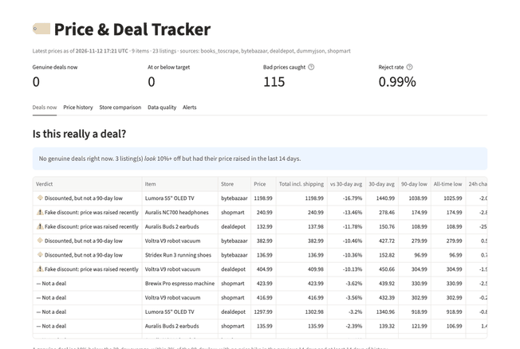
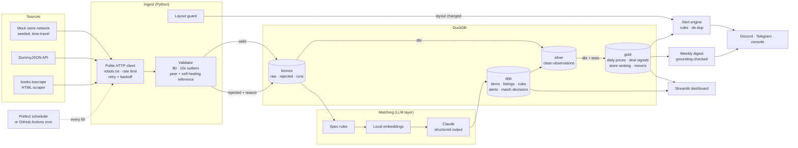

# 🏷️ Price & Deal Tracker

[](https://github.com/Bhuvana-SK/price-deal-tracker/actions/workflows/ci.yml)


**An automated data pipeline that tracks product prices across stores, keeps the full price history, tells genuine deals apart from fake "discounts", and sends de-duplicated alerts, with a small LLM layer for product matching.**



---

## What it does, in 30 seconds

| | |
|---|---|
| **Collects** prices on a schedule from a public API, a scraping sandbox and a realistic mock store network | `requests`/`httpx`, robots.txt, rate limits, retries with backoff |
| **Rejects bad data** before storing it: `$0` prices, 100x spikes, layout changes | 114 of 11,544 rows rejected and logged in the demo |
| **Stores** every observation idempotently in DuckDB, in bronze → silver → gold layers | re-running never duplicates a row |
| **Decides "is this really a deal?"** with dbt: 30/90-day averages, all-time low, and a check for prices raised just before a "sale" | 83% precision vs. 34% for a naive rule |
| **Alerts** on target price, 90-day low, 15%+ drops and genuine deals, without repeats | Discord, Telegram or console |
| **Uses Claude where it helps**: matching listings to products, plain-English alert rules, a weekly digest | every LLM feature works without an API key |
| **Shows it all** in a Streamlit dashboard | price history, deal verdicts, store comparison, data quality |

Everything runs locally with **no accounts and no API keys**. All data is synthetic or public sample data.

---

## Quick start

**With Docker** (3 commands, then open http://localhost:8501):

```bash
git clone https://github.com/Bhuvana-SK/price-deal-tracker.git && cd price-deal-tracker
docker compose up --build      # creates the DB, backfills 120 days, starts scheduler + dashboard
```

**Without Docker** (needs [uv](https://docs.astral.sh/uv/)):

```bash
make install     # Python 3.11 venv with pinned deps, dbt packages, git hooks
make demo        # seed the watchlist, 120 days of mock history, one full pipeline run
make dashboard   # http://localhost:8501
```

Optional: copy `.env.example` to `.env` and add `ANTHROPIC_API_KEY`, `DISCORD_WEBHOOK_URL` and/or Telegram credentials.

---

## Architecture



Each scheduled run: **ingest each source → match new listings to products → `dbt build` (models + 44 data tests) → alerts**. Price alerts pause automatically if a dbt test fails, so you're never alerted on bad data.

---

## Results

### 1. Is the deal rule better than a naive one?

The mock store network plants **genuine sales** and **fake deals** (price raised by 25–40% for two weeks, then "discounted" back to normal), so every day has a known answer. Each strategy only sees data from *before* the day it judges.

Backtest on 8,448 listing-days (24 listings, 365 days):

| Strategy | Precision | Genuine sales caught | Fake deals flagged | False alarms / listing / month |
|---|---:|---:|---:|---:|
| Naive: 10%+ below 30-day avg | 34% | 142/143 (99%) | 61/71 | 3.41 |
| Naive: 10%+ drop vs. yesterday | 67% | 143/143 (100%) | **70/71** | 0.25 |
| Naive: at 90-day low | 70% | 80/143 (56%) | 11/71 | 0.25 |
| **Deal rule (this project)** | **83%** | 89/143 (62%) | **3/71** | **0.20** |

**Deal rule:** the price is ≥10% below its 30-day average, within 3% of its 90-day low, there was no price hike in the previous 14 days, and the listing has at least 14 days of history. The thresholds are dbt `vars` and weren't tuned on this backtest.

**What this shows:** the rule is the most precise and almost never fooled by a fake discount. The cost is recall: it misses sales that come soon after a deeper sale. A "drop vs. yesterday" rule catches every sale but also every fake one. Reproduce with `make backtest`; output in [`eval/results/deal_backtest.md`](eval/results/deal_backtest.md).

### 2. Are these two listings the same product?

On 84 hand-labelled title pairs (made-up brands; hard cases include storage, size and colour variants, accessories, bundles, refurbished units and next-generation models), thresholds were tuned on the 42 dev pairs and results are reported on the 42 **test** pairs:

| Method | Precision | Recall | F1 |
|---|---:|---:|---:|
| Fuzzy string match (baseline) | 38% | 94% | 0.55 |
| Embeddings only (`bge-small-en-v1.5`, local) | 43% | 100% | 0.60 |
| Embeddings + spec rules | 46% | 100% | 0.63 |
| Embeddings + rules + Claude | *pending: run `tracker eval-matching --live` with an API key* | | |

**What this shows:** sentence embeddings can't separate near-identical *different* products. `Voltra V9` vs `V9+` scores 0.996 and `128GB` vs `256GB` scores 0.91, compared with 0.93 for a true match. So embeddings are used only to **rule out** obvious non-matches (below a cutoff that keeps every dev-set match), and the remaining pairs go to Claude for a structured verdict. Claude's verdicts are cached in `eval/results/` so the table can be reproduced without a key. Details and every error: [`eval/results/matching.md`](eval/results/matching.md). The labelling rule: [`eval/data/README.md`](eval/data/README.md).

---

## Data quality and reliability

| Concern | How it's handled | Where |
|---|---|---|
| Impossible prices | `$0`/negative, absurd, and 10x-off-typical prices rejected with a reason, stored in `bronze.rejected_observations`, counted per run and shown in the dashboard | [`ingest/validate.py`](src/tracker/ingest/validate.py) |
| A glitch on day one | New listings are checked against the median of all stores selling the item. A poisoned reference resets after 3 consistent prices. *Found by a Docker run whose window started on a planted spike; regression-tested.* | [`ingest/reference.py`](src/tracker/ingest/reference.py) |
| Duplicates on rerun | `observation_key = hash(source, listing, check window)` + `ON CONFLICT DO NOTHING`; a failed load rolls back completely | [`storage/repo.py`](src/tracker/storage/repo.py) |
| Flaky sources | Retries with exponential backoff and jitter on 429/5xx/connection errors; 4xx not retried; one failing source never stops the others | [`sources/http.py`](src/tracker/sources/http.py) |
| Being a good citizen | robots.txt checked per RFC 9309; per-host rate limit; descriptive User-Agent | [`sources/http.py`](src/tracker/sources/http.py) |
| Site layout changes | If most records stop parsing, the run is marked `partial` and a system alert is sent (once a day) | [`ingest/layout_guard.py`](src/tracker/ingest/layout_guard.py) |
| Transformation correctness | 44 dbt tests: `not_null`, `unique`, `accepted_range`, `relationships`, `accepted_values`, plus a no-future-leakage test and a deal-consistency test | [`dbt/`](dbt/) |
| Alert spam | Repeat only after 7 days or a further 2% drop; failed deliveries retried next run | [`alerts/dedupe.py`](src/tracker/alerts/dedupe.py) |
| LLM making things up | Strict schemas via structured outputs; rules validated against the watchlist; digest numbers must match computed facts or the template is used | [`llm/`](src/tracker/llm/) |
| Observability | Structured logs (JSON in containers), a run log with counters, an audit log for every alert and match decision | `bronze.ingest_runs`, `app.alerts_sent`, `app.match_decisions` |

---

## Data model

| Layer | Table | Grain / purpose |
|---|---|---|
| bronze | `raw_observations` | one validated price per listing per check window (raw payload kept) |
| bronze | `rejected_observations` | every refused price, with reason |
| bronze | `ingest_runs` | one row per run: status, attempted/loaded/duplicate/rejected, layout flag |
| app | `items`, `listings`, `item_listings` | watchlist, listings found, and which listing belongs to which item (`is_match`) |
| app | `rules`, `alerts_sent`, `match_decisions` | custom alert rules, alert audit log, matching audit log |
| silver | `stg_price_observations`, `stg_items` | typed, de-duplicated, joined to item; excludes mismatched listings |
| gold | `fct_price_daily` | item × listing × day: min/max/close |
| gold | `fct_listing_daily_signals` | backward-looking 30/90-day avg, lows, inflation check, **deal flag + reason** (also the backtest input) |
| gold | `mart_listing_current` | latest price per listing with 24h change (ASOF join) and verdict |
| gold | `mart_store_comparison` | listings ranked by price + shipping |
| gold | `mart_item_price_daily`, `mart_weekly_movers`, `mart_data_quality_daily` | best price per day, weekly moves, loaded vs. rejected |

---

## Tech choices

| Choice | Why |
|---|---|
| **DuckDB** | Free, zero-setup analytical database; great for a single-node pipeline. Bulk inserts use columnar `unnest`, about 200x faster than `executemany`. |
| **dbt (dbt-duckdb)** | Deal logic as tested, documented SQL; thresholds are `vars`. |
| **Prefect over Airflow** | Flows are plain Python and run as a script. Airflow would add a scheduler, webserver and metadata DB for one pipeline. The logic lives in plain functions (`orchestrate.py`), so **GitHub Actions cron** is a drop-in lightweight alternative. |
| **No Playwright** | Sites that need JavaScript rendering usually forbid scraping. The scraper targets `books.toscrape.com`, a sandbox built for it; the source interface allows adding a browser later. |
| **fastembed (local ONNX)** | Embeddings without an account or GPU. The Claude API has no embeddings endpoint, and torch would triple the image size. |
| **Claude Haiku 5.5** (`CLAUDE_MODEL`) | Matching verification and rule parsing are short classification-style calls; Haiku is fast and cheap. Structured outputs (`messages.parse` + Pydantic) remove JSON parsing errors. |
| **Streamlit + Altair** | A dashboard in one Python file, with hover tooltips and a light/dark palette. |
| **uv** | Fast, reproducible installs from `uv.lock` (`requirements*.txt` exported for pip users). |

---

## Project layout

```
src/tracker/
  sources/      mock store network, DummyJSON API, books.toscrape scraper, polite HTTP client
  ingest/       validation, peer/self-healing reference, layout guard, run orchestration
  storage/      DuckDB schema + repository (all SQL outside dbt lives here)
  llm/          Claude client, embeddings, spec rules, matching, NL rules, digest
  alerts/       rules, de-duplication, notifiers, engine
  dashboard/    data access, palette, Altair charts
  evaluation/   deal backtest, matching eval
  flows/        Prefect flows (thin wrappers over orchestrate.py)
  orchestrate.py, transform.py, cli.py, settings.py
dbt/            silver + gold models, 44 data tests
dashboard/      Streamlit app
eval/           labelled pairs, results tables, cached LLM verdicts
tests/          unit + integration (temp DuckDB, real dbt, headless Streamlit, Prefect)
```

Common commands: `make help`. Useful CLI commands:

```bash
tracker deals                                  # "is this really a deal?" for every listing
tracker rule "tell me if the auralis headphones drop below \$200"
tracker match                                  # check listings belong to their item
tracker digest                                 # weekly "what moved" summary
tracker runs                                   # recent runs + rejection counts
```

**Quality gates:** `ruff`, strict `mypy`, 133 tests (unit and integration, all offline), pre-commit hooks, and GitHub Actions CI (tests + Docker build) plus a scheduled pipeline workflow.

---

## Limitations

- **The interesting price history is synthetic.** The live sources work (DummyJSON, books.toscrape), but their prices don't change. The mock store network is realistic but designed by me, so the backtest checks the logic, not real-world performance.
- **The matching set is small and self-authored.** 84 pairs, written and labelled by the same person who wrote the spec rules, so treat the results as a sanity check. The Claude row is pending until it's run with an API key.
- **Deal-rule recall is 62%.** It's deliberately conservative: it misses sales soon after a deeper sale.
- **Single currency per item, no FX.** `books.toscrape` prices are GBP and are compared only with themselves.
- **DuckDB is single-writer.** Fine for one scheduler; the dashboard reads read-only and retries if the pipeline holds the lock.
- **GitHub Actions persistence uses the Actions cache**, which is evicted after 7 days without use. Durable storage would need object storage.
- **The Docker image is about 2.3 GB**, mostly dbt, Prefect and Streamlit in one image.
- **No auth on the dashboard.** It's meant for local or private use.

## What I'd do next

1. **Run the Claude matching eval** with a key, add the row above, and grow the labelled set with real (licensed) listing data.
2. **A real retail source** via an official API (e.g. Best Buy Products API) behind the same `Source` interface.
3. **Incremental dbt models** for `fct_price_daily` and signals once history grows. Today everything is rebuilt in about 1 s.
4. **Tune the deal rule on a separate validation period** and report on a later one, with a precision/recall curve rather than one point.
5. **Durable state:** Parquet in object storage (or MotherDuck) instead of the Actions cache, and split the image into pipeline and dashboard images.
6. **Price forecasting** ("wait or buy now?") evaluated against the same backtest, kept only if it beats the rule.

## License

[MIT](LICENSE)
